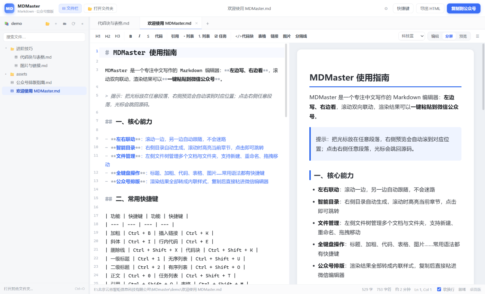
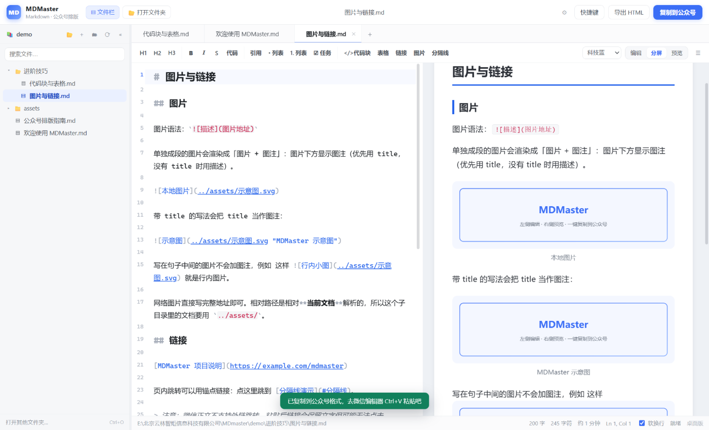
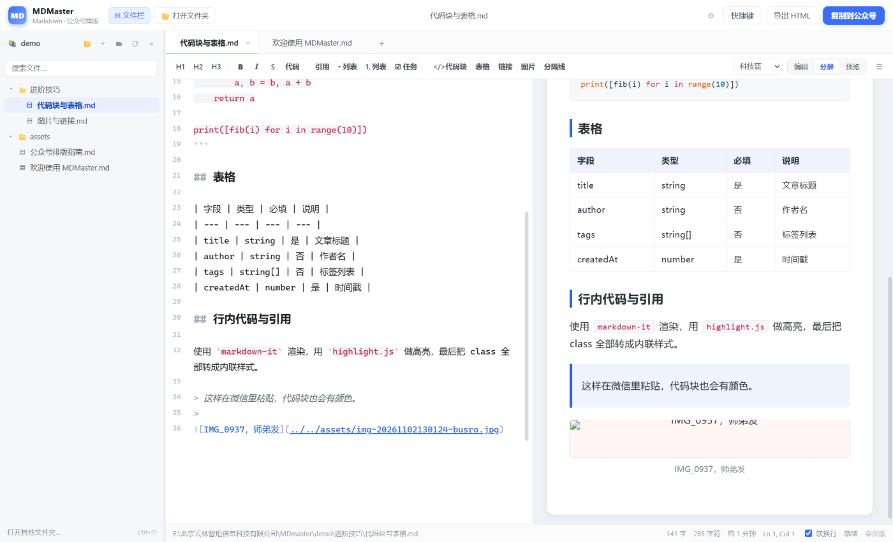
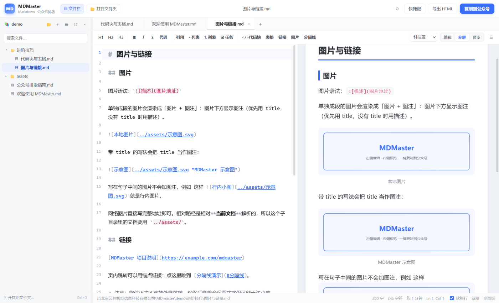
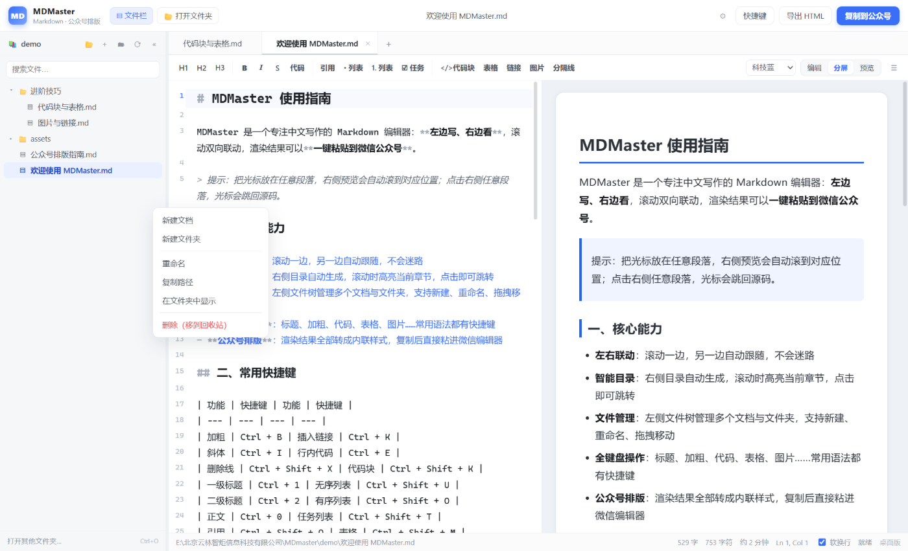
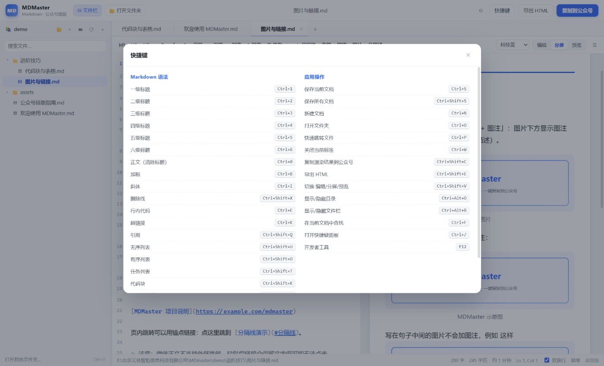
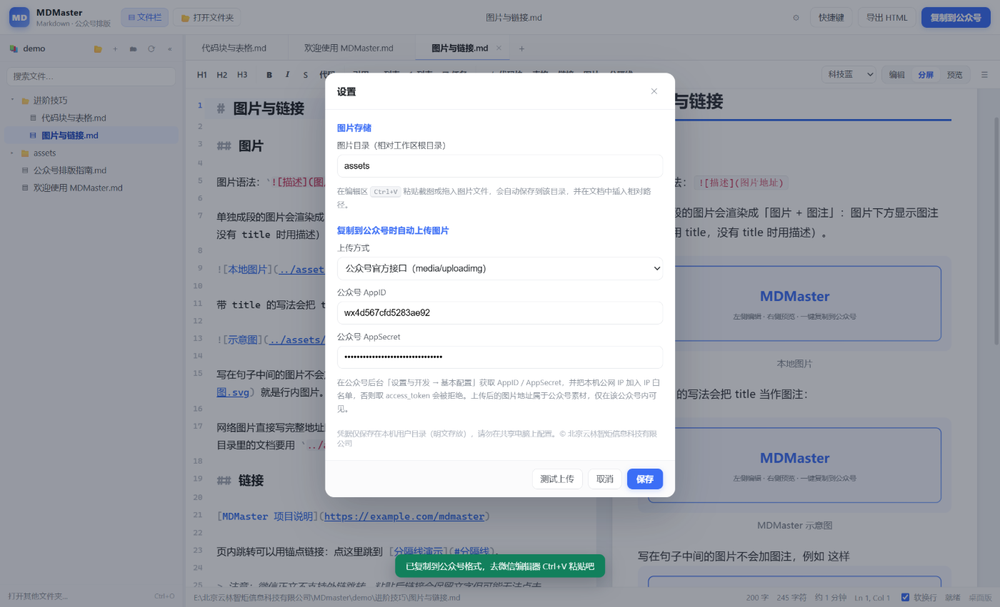

# 公众号排版太折腾，我写了个 Markdown 编辑器 MDMaster

写公众号最烦的不是写内容，是排版。

代码块从编辑器粘到公众号后台，高亮全没了；表格粘过去边框消失；标题字号还得一个个手动调。我以前一直用 mdnice，样式是在线的，但图片得走图床，图挂了还得回去重新传。

所以干脆自己写了一个桌面版的，叫 MDMaster。左边写 Markdown，右边实时预览，写完直接复制，粘到公众号编辑器里样式不丢。

## 界面

左边源码、右边预览，两边滚动是联动的：滚左边右边跟着走，点右边任意一段，光标会跳回对应的源码行。

最右侧那一列是自动生成的目录，写长文的时候好用，滚到哪高亮到哪，点一下就跳过去。

## 复制到公众号

这是我最常用的功能。

点「复制到公众号」，然后去公众号后台正文里 Ctrl+V，标题、正文、列表、引用、表格、代码高亮全都在。

原理不复杂：渲染的时候每个标签的样式都写成行内 style，公众号编辑器只认行内样式，所以粘过去不会掉。

配色有四套，简约黑白、微信绿、科技蓝、暖阳橙，我一般用科技蓝，跟地图的颜色比较接近。

## 图片直接粘

以前写一篇带图的推文，截图、存文件、传图床、复制链接、写成 ``，五步，图多了就烦。

现在编辑区直接 Ctrl+V 粘截图，软件自动把图片存到工程目录的 assets 文件夹，然后在文档里插好相对路径。

单独一段的图片会自动加图注，优先用 title，没写就用描述。写在句子中间的图片就不加，免得正文里插一行字。

复制到公众号的时候，如果配了公众号的 AppID 和 AppSecret，本地图片还会自动传到公众号素材库换成公网地址，粘过去直接显示，不用再一张张手动上传。这个要先把本机公网 IP 加到公众号的 IP 白名单里，不然接口会拒绝。

## 文件管理

写系列文章的时候一个文件夹十几个 md，以前只能一个个点开。

MDMaster 是直接把一个文件夹打开成工程，左边树形列出所有 md 和子文件夹，能新建、重命名、拖拽移动、右键删到回收站，还有搜索框过滤。多个文档可以标签页同时开着，改完 0.7 秒自动保存。

## 快捷键

加粗 Ctrl+B、标题 Ctrl+1~6、代码块 Ctrl+Shift+K、表格 Ctrl+Shift+M，常用的都在，Ctrl+/ 打开面板看全部。

## 安装

Windows 安装包放在 GitHub，直接下：

https://github.com/ylzjgit/MDmaster/releases/latest/download/MDMaster-Setup-1.0.0.exe

双击安装，按当前用户装，不用管理员权限，安装包自带运行环境，不用另外装 Node.js。

第一次运行 Windows 可能会弹「Windows 已保护你的电脑」，点「更多信息 → 仍要运行」就行，没做代码签名，所以有这个提示。

## 最后

源码在 GitHub，用的是 PolyForm 非商业许可：自己用、改、发给同学都没问题，别拿去卖或者做商业服务就行，商业使用可以找我。

https://github.com/ylzjgit/MDmaster

有 bug 或者想要什么功能，GitHub 上提 issue，或者公众号后台留言。用着还行的话，帮忙点个 star。
